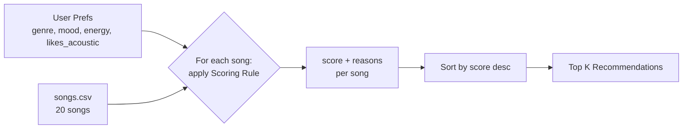

# 🎵 Music Recommender Simulation

## Project Summary

In this project you will build and explain a small music recommender system.

Your goal is to:

- Represent songs and a user "taste profile" as data
- Design a scoring rule that turns that data into recommendations
- Evaluate what your system gets right and wrong
- Reflect on how this mirrors real world AI recommenders

Replace this paragraph with your own summary of what your version does.

---

## How The System Works

### How real-world recommenders work

Platforms like Spotify, YouTube, and TikTok blend two main strategies. **Collaborative filtering** looks at *other users' behavior*: if people who share your listening history also loved a song you haven't heard, it gets recommended to you, without the system knowing anything about the song itself. **Content-based filtering** looks at *the items' attributes*: if you play a lot of low-energy, acoustic, chill tracks, the system finds other songs whose audio features (tempo, energy, valence, acousticness, etc.) are similar. Real systems combine both, using signals such as plays, skips, likes, saves, playlist adds, repeat listens, and listening time, plus audio features and metadata like genre, mood, and tempo. At scale they turn these into learned vectors ("embeddings") and rank millions of candidates in milliseconds.

My simulation is a small **content-based** recommender. It has no other users to learn from, so it compares each song's attributes directly against one listener's taste profile. It prioritizes **genre first, mood second, and energy closeness third**, with a small bonus for matching the listener's preference for acoustic vs. produced sound.

### Features used

**`Song`** (one row of `data/songs.csv`)

| Feature | Type | Used in scoring? |
| --- | --- | --- |
| `genre` | category (pop, lofi, rock, metal, ...) | Yes (exact match) |
| `mood` | category (happy, chill, intense, sad, ...) | Yes (exact match) |
| `energy` | 0.0 – 1.0 | Yes (closeness to target) |
| `acousticness` | 0.0 – 1.0 | Yes (small bonus) |
| `tempo_bpm`, `valence`, `danceability` | numeric | Not yet, candidates for later experiments |
| `id`, `title`, `artist` | identifiers | Display only |

**`UserProfile`**

- `favorite_genre`: e.g. `"pop"`
- `favorite_mood`: e.g. `"happy"`
- `target_energy`: e.g. `0.8` (the energy level they *want*, not "more is better")
- `likes_acoustic`: `True` / `False`

The example profile in `src/main.py` is an upbeat pop listener:

```python
user_prefs = {"genre": "pop", "mood": "happy", "energy": 0.8, "likes_acoustic": False}
```

**Profile critique:** genre + mood alone would be too narrow, since any song outside "pop" and "happy" would tie at zero. Adding `target_energy` and `likes_acoustic` lets the system tell "intense rock" (energy ≈ 0.9, acousticness ≈ 0.1) apart from "chill lofi" (energy ≈ 0.4, acousticness ≈ 0.7) even when neither matches the favorite genre, so the non-matching songs still get a sensible order.

### Dataset

The starter catalog had 10 songs. I added 10 more (ids 11–20) to cover genres and moods that were missing: hip-hop/confident, metal/angry, classical/peaceful, country/nostalgic, r&b/romantic, edm/euphoric, reggae/uplifting, folk/sad, blues/melancholy, and punk/rebellious. The catalog now spans 17 genres and 16 moods, with energies from 0.18 to 0.97.

### Algorithm Recipe

**Scoring Rule (judges one song):**

| Signal | Points |
| --- | --- |
| Genre matches `favorite_genre` | **+2.0** |
| Mood matches `favorite_mood` | **+1.0** |
| Energy similarity | **+1.5 × (1 − \|song.energy − target_energy\|)** |
| Acoustic fit | **+0.5 × acousticness** if `likes_acoustic`, otherwise **+0.5 × (1 − acousticness)** |

Maximum possible score is 5.0. The energy term rewards songs that are *close* to the target instead of simply higher or lower: a song at exactly the target energy earns the full 1.5, and the points shrink linearly as the gap grows. Genre gets the most weight because it is the strongest, most stable signal of taste. Mood is worth half as much because it changes with context (the same person wants "chill" at night and "intense" at the gym).

Each rule that fires also adds a human-readable reason (e.g. `"genre match (+2.0)"`, `"energy 0.82 close to target 0.80 (+1.47)"`) so every recommendation can be explained.

**Ranking Rule (orders the whole catalog):**

1. Score every song in the catalog with the Scoring Rule.
2. Sort by score, highest first (ties broken by smaller energy gap).
3. Return the top `k` (default 5) along with their reasons.

We need both: the Scoring Rule answers "how good is *this* song for *this* user?", while the Ranking Rule turns those independent judgments into a choice, comparing every song against the others and deciding which few to actually show.

### Data flow



### Expected biases and limitations

- **Genre dominance:** a +2.0 genre match outweighs a perfect mood *and* energy fit, so a great "happy, 0.8 energy" indie-pop or edm track can rank below a mediocre pop song. Users may get stuck in a genre "filter bubble."
- **Exact-string matching:** "pop" and "indie pop" are treated as completely different genres, and "chill" vs. "relaxed" as different moods, even though a listener would see them as close.
- **One mood, one genre:** real people have several favorites; a single-valued profile can't represent a mixed taste.
- **Small, hand-made catalog:** with only 1–3 songs per genre, rare genres either dominate a matching user's list or never appear at all, and the numeric values reflect my own judgment, not measured audio data.
- **No feedback loop:** unlike real platforms, the system never learns from skips or likes, so its mistakes never get corrected.

---

## Getting Started

### Setup

1. Create a virtual environment (optional but recommended):

   ```bash
   python -m venv .venv
   source .venv/bin/activate      # Mac or Linux
   .venv\Scripts\activate         # Windows

2. Install dependencies

```bash
pip install -r requirements.txt
```

3. Run the app:

```bash
python -m src.main
```

### Running Tests

Run the starter tests with:

```bash
pytest
```

You can add more tests in `tests/test_recommender.py`.

---

## Sample Recommendation Output

Paste a sample of your recommender's output here as a text block so a reader can see what it produces:

```
# e.g.:
# User profile: genre=indie, mood=chill, energy=low
# Recommendations:
#   1. ...
#   2. ...
#   3. ...
```

**Screenshot or video** *(optional)*: <!-- Insert a screenshot or demo video link here -->

---

## Experiments You Tried

Use this section to document the experiments you ran. For example:

- What happened when you changed the weight on genre from 2.0 to 0.5
- What happened when you added tempo or valence to the score
- How did your system behave for different types of users

---

## Limitations and Risks

Summarize some limitations of your recommender.

Examples:

- It only works on a tiny catalog
- It does not understand lyrics or language
- It might over favor one genre or mood

You will go deeper on this in your model card.

---

## Reflection

Read and complete `model_card.md`:

[**Model Card**](model_card.md)

Write 1 to 2 paragraphs here about what you learned:

- about how recommenders turn data into predictions
- about where bias or unfairness could show up in systems like this


