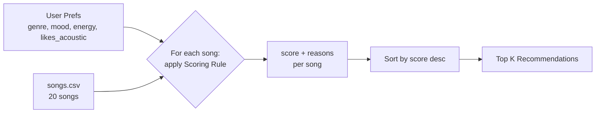

# 🎵 Music Recommender Simulation

## Project Summary

In this project you will build and explain a small music recommender system.

Your goal is to:

- Represent songs and a user "taste profile" as data
- Design a scoring rule that turns that data into recommendations
- Evaluate what your system gets right and wrong
- Reflect on how this mirrors real world AI recommenders

My version, **VibeFinder 1.0**, is a small content-based recommender that runs in the terminal. It loads 20 songs from `data/songs.csv`, scores each one against a listener's favorite genre, favorite mood, target energy, and acoustic preference, and prints the top 5 with a plain-language reason for every point awarded. I stress-tested it with six user profiles (including adversarial ones) and ran a weight-shift experiment to see how sensitive the rankings are to the weights.

---

## How The System Works

### How real-world recommenders work

Platforms like Spotify, YouTube, and TikTok blend two main strategies. **Collaborative filtering** looks at *other users' behavior*: if people who share your listening history also loved a song you haven't heard, it gets recommended to you, without the system knowing anything about the song itself. **Content-based filtering** looks at *the items' attributes*: if you play a lot of low-energy, acoustic, chill tracks, the system finds other songs whose audio features (tempo, energy, valence, acousticness, etc.) are similar. Real systems combine both, using signals such as plays, skips, likes, saves, playlist adds, repeat listens, and listening time, plus audio features and metadata like genre, mood, and tempo. At scale they turn these into learned vectors ("embeddings") and rank millions of candidates in milliseconds.

My simulation is a small **content-based** recommender. It has no other users to learn from, so it compares each song's attributes directly against one listener's taste profile. It prioritizes **genre first, mood second, and energy closeness third**, with a small bonus for matching the listener's preference for acoustic vs. produced sound.

### Features used

**`Song`** (one row of `data/songs.csv`)

| Feature | Type | Used in scoring? |
| --- | --- | --- |
| `genre` | category (pop, lofi, rock, metal, ...) | Yes (exact match) |
| `mood` | category (happy, chill, intense, sad, ...) | Yes (exact match) |
| `energy` | 0.0 – 1.0 | Yes (closeness to target) |
| `acousticness` | 0.0 – 1.0 | Yes (small bonus) |
| `tempo_bpm`, `valence`, `danceability` | numeric | Not yet, candidates for later experiments |
| `popularity`, `release_decade`, `mood_tags`, `instrumentalness`, `liveness` | advanced (Challenge 1) | Yes, only when the profile asks for them (see [Optional Extensions](#optional-extensions)) |
| `id`, `title`, `artist` | identifiers | Display only (`artist` is also used by the diversity penalty) |

**`UserProfile`**

- `favorite_genre`: e.g. `"pop"`
- `favorite_mood`: e.g. `"happy"`
- `target_energy`: e.g. `0.8` (the energy level they *want*, not "more is better")
- `likes_acoustic`: `True` / `False`

The example profile in `src/main.py` is an upbeat pop listener:

```python
user_prefs = {"genre": "pop", "mood": "happy", "energy": 0.8, "likes_acoustic": False}
```

**Profile critique:** genre + mood alone would be too narrow, since any song outside "pop" and "happy" would tie at zero. Adding `target_energy` and `likes_acoustic` lets the system tell "intense rock" (energy ≈ 0.9, acousticness ≈ 0.1) apart from "chill lofi" (energy ≈ 0.4, acousticness ≈ 0.7) even when neither matches the favorite genre, so the non-matching songs still get a sensible order.

### Dataset

The starter catalog had 10 songs. I added 10 more (ids 11–20) to cover genres and moods that were missing: hip-hop/confident, metal/angry, classical/peaceful, country/nostalgic, r&b/romantic, edm/euphoric, reggae/uplifting, folk/sad, blues/melancholy, and punk/rebellious. The catalog now spans 17 genres and 16 moods, with energies from 0.18 to 0.97.

### Algorithm Recipe

**Scoring Rule (judges one song):**

| Signal | Points |
| --- | --- |
| Genre matches `favorite_genre` | **+2.0** |
| Mood matches `favorite_mood` | **+1.0** |
| Energy similarity | **+1.5 × (1 − \|song.energy − target_energy\|)** |
| Acoustic fit | **+0.5 × acousticness** if `likes_acoustic`, otherwise **+0.5 × (1 − acousticness)** |

Maximum possible score is 5.0. The energy term rewards songs that are *close* to the target instead of simply higher or lower: a song at exactly the target energy earns the full 1.5, and the points shrink linearly as the gap grows. Genre gets the most weight because it is the strongest, most stable signal of taste. Mood is worth half as much because it changes with context (the same person wants "chill" at night and "intense" at the gym).

Each rule that fires also adds a human-readable reason (e.g. `"genre match (+2.0)"`, `"energy 0.82 close to target 0.80 (+1.47)"`) so every recommendation can be explained.

**Ranking Rule (orders the whole catalog):**

1. Score every song in the catalog with the Scoring Rule.
2. Sort by score, highest first (ties broken by smaller energy gap).
3. Return the top `k` (default 5) along with their reasons.

We need both: the Scoring Rule answers "how good is *this* song for *this* user?", while the Ranking Rule turns those independent judgments into a choice, comparing every song against the others and deciding which few to actually show.

### Data flow



### Expected biases and limitations

- **Genre dominance:** a +2.0 genre match outweighs a perfect mood *and* energy fit, so a great "happy, 0.8 energy" indie-pop or edm track can rank below a mediocre pop song. Users may get stuck in a genre "filter bubble."
- **Exact-string matching:** "pop" and "indie pop" are treated as completely different genres, and "chill" vs. "relaxed" as different moods, even though a listener would see them as close.
- **One mood, one genre:** real people have several favorites; a single-valued profile can't represent a mixed taste.
- **Small, hand-made catalog:** with only 1–3 songs per genre, rare genres either dominate a matching user's list or never appear at all, and the numeric values reflect my own judgment, not measured audio data.
- **No feedback loop:** unlike real platforms, the system never learns from skips or likes, so its mistakes never get corrected.

---

## Getting Started

### Setup

1. Create a virtual environment (optional but recommended):

   ```bash
   python -m venv .venv
   source .venv/bin/activate      # Mac or Linux
   .venv\Scripts\activate         # Windows
   ```

2. Install dependencies

```bash
pip install -r requirements.txt
```

3. Run the app:

```bash
python -m src.main
```

   Optional flags (combine freely):

   | Flag | What it does |
   | --- | --- |
   | `--list` | list profile names and scoring modes |
   | `--profile NAME` | run only profiles whose name contains `NAME` (e.g. `--profile lofi`) |
   | `--mode MODE` | `genre-first` (default), `mood-first`, or `energy-focused` |
   | `--compare-modes` | run each profile under every scoring mode |
   | `--diverse` | apply the diversity penalty to the top 5 |
   | `--table` | print an ASCII summary table (with reasons) instead of lists |

```bash
python -m src.main --profile pop --compare-modes --table
```

### Running Tests

Run the starter tests with:

```bash
pytest
```

You can add more tests in `tests/test_recommender.py`.

---

## Sample Recommendation Output

Output of `python -m src.main` for the default "High-Energy Pop" profile:

```
Loaded songs: 20
================================================================
Profile: High-Energy Pop (default)
  (genre=pop, mood=happy, energy=0.8, likes_acoustic=False)
----------------------------------------------------------------
1. Sunrise City by Neon Echo  [pop, happy]
   Score: 4.88 / 5.00
     - genre match: pop (+2.0)
     - mood match: happy (+1.0)
     - energy 0.82 vs target 0.80 (+1.47)
     - produced sound fit (+0.41)
2. Gym Hero by Max Pulse  [pop, intense]
   Score: 3.78 / 5.00
     - genre match: pop (+2.0)
     - energy 0.93 vs target 0.80 (+1.30)
     - produced sound fit (+0.47)
3. Rooftop Lights by Indigo Parade  [indie pop, happy]
   Score: 2.77 / 5.00
     - mood match: happy (+1.0)
     - energy 0.76 vs target 0.80 (+1.44)
     - produced sound fit (+0.33)
4. Concrete Crown by Block Theory  [hip-hop, confident]
   Score: 1.91 / 5.00
     - energy 0.78 vs target 0.80 (+1.47)
     - produced sound fit (+0.44)
5. Paper Hearts Riot by The Static Kids  [punk, rebellious]
   Score: 1.82 / 5.00
     - energy 0.89 vs target 0.80 (+1.36)
     - produced sound fit (+0.46)
```

This matches intuition: *Sunrise City* is the only song that is pop **and** happy with energy right at the target, so it wins by a full point. *Gym Hero* comes second because the +2.0 genre bonus outweighs its "intense" mood, while *Rooftop Lights* (indie pop, happy) is a better vibe match but loses the genre points because "indie pop" is not an exact match for "pop".

**Screenshot or video** *(optional)*: <!-- Insert a screenshot or demo video link here -->

---

## Experiments You Tried

### Stress test: six user profiles

`python -m src.main` runs every profile in `PROFILES` (in `src/main.py`) and prints the top 5. Three are "normal" listeners and three are edge cases designed to trick the scoring.

#### High-Energy Pop (default)

```
================================================================
Profile: High-Energy Pop (default)
  (genre=pop, mood=happy, energy=0.8, likes_acoustic=False)
----------------------------------------------------------------
1. Sunrise City by Neon Echo  [pop, happy]
   Score: 4.88 / 5.00
     - genre match: pop (+2.0)
     - mood match: happy (+1.0)
     - energy 0.82 vs target 0.80 (+1.47)
     - produced sound fit (+0.41)
2. Gym Hero by Max Pulse  [pop, intense]
   Score: 3.78 / 5.00
     - genre match: pop (+2.0)
     - energy 0.93 vs target 0.80 (+1.30)
     - produced sound fit (+0.47)
3. Rooftop Lights by Indigo Parade  [indie pop, happy]
   Score: 2.77 / 5.00
     - mood match: happy (+1.0)
     - energy 0.76 vs target 0.80 (+1.44)
     - produced sound fit (+0.33)
4. Concrete Crown by Block Theory  [hip-hop, confident]
   Score: 1.91 / 5.00
     - energy 0.78 vs target 0.80 (+1.47)
     - produced sound fit (+0.44)
5. Paper Hearts Riot by The Static Kids  [punk, rebellious]
   Score: 1.82 / 5.00
     - energy 0.89 vs target 0.80 (+1.36)
     - produced sound fit (+0.46)
```

Matches intuition. The one pop + happy song wins easily; *Gym Hero* sneaks into #2 on genre points alone even though "intense" is not "happy."

#### Chill Lofi

```
================================================================
Profile: Chill Lofi
  (genre=lofi, mood=chill, energy=0.35, likes_acoustic=True)
----------------------------------------------------------------
1. Library Rain by Paper Lanterns  [lofi, chill]
   Score: 4.93 / 5.00
     - genre match: lofi (+2.0)
     - mood match: chill (+1.0)
     - energy 0.35 vs target 0.35 (+1.50)
     - acoustic sound fit (+0.43)
2. Midnight Coding by LoRoom  [lofi, chill]
   Score: 4.75 / 5.00
     - genre match: lofi (+2.0)
     - mood match: chill (+1.0)
     - energy 0.42 vs target 0.35 (+1.40)
     - acoustic sound fit (+0.35)
3. Focus Flow by LoRoom  [lofi, focused]
   Score: 3.81 / 5.00
     - genre match: lofi (+2.0)
     - energy 0.40 vs target 0.35 (+1.42)
     - acoustic sound fit (+0.39)
4. Spacewalk Thoughts by Orbit Bloom  [ambient, chill]
   Score: 2.85 / 5.00
     - mood match: chill (+1.0)
     - energy 0.28 vs target 0.35 (+1.40)
     - acoustic sound fit (+0.46)
5. Coffee Shop Stories by Slow Stereo  [jazz, relaxed]
   Score: 1.92 / 5.00
     - energy 0.37 vs target 0.35 (+1.47)
     - acoustic sound fit (+0.45)
```

Feels exactly right: all three lofi tracks first, then the ambient "chill" song, then quiet acoustic jazz. This profile is well served because the catalog has 3 lofi songs.

#### Deep Intense Rock

```
================================================================
Profile: Deep Intense Rock
  (genre=rock, mood=intense, energy=0.9, likes_acoustic=False)
----------------------------------------------------------------
1. Storm Runner by Voltline  [rock, intense]
   Score: 4.93 / 5.00
     - genre match: rock (+2.0)
     - mood match: intense (+1.0)
     - energy 0.91 vs target 0.90 (+1.48)
     - produced sound fit (+0.45)
2. Gym Hero by Max Pulse  [pop, intense]
   Score: 2.93 / 5.00
     - mood match: intense (+1.0)
     - energy 0.93 vs target 0.90 (+1.46)
     - produced sound fit (+0.47)
3. Paper Hearts Riot by The Static Kids  [punk, rebellious]
   Score: 1.94 / 5.00
     - energy 0.89 vs target 0.90 (+1.48)
     - produced sound fit (+0.46)
4. Laser Tide by Pulse Atlas  [edm, euphoric]
   Score: 1.91 / 5.00
     - energy 0.95 vs target 0.90 (+1.43)
     - produced sound fit (+0.48)
5. Iron Cathedral by Ashen Vow  [metal, angry]
   Score: 1.88 / 5.00
     - energy 0.97 vs target 0.90 (+1.40)
     - produced sound fit (+0.48)
```

#1 is perfect, but there is only **one** rock song, so #2–#5 are pop, punk, edm, and metal picked purely for being loud. Metal is the closest real neighbor to rock, yet it lands last because its energy (0.97) is slightly *too* high.

#### Conflicted (energy 0.9 + sad)

```
================================================================
Profile: Conflicted (energy 0.9 + sad)
  (genre=folk, mood=sad, energy=0.9, likes_acoustic=True)
----------------------------------------------------------------
1. Empty Train Platform by June Harrow  [folk, sad]
   Score: 3.99 / 5.00
     - genre match: folk (+2.0)
     - mood match: sad (+1.0)
     - energy 0.26 vs target 0.90 (+0.54)
     - acoustic sound fit (+0.45)
2. Storm Runner by Voltline  [rock, intense]
   Score: 1.53 / 5.00
     - energy 0.91 vs target 0.90 (+1.48)
     - acoustic sound fit (+0.05)
3. Paper Hearts Riot by The Static Kids  [punk, rebellious]
   Score: 1.52 / 5.00
     - energy 0.89 vs target 0.90 (+1.48)
     - acoustic sound fit (+0.04)
4. Gym Hero by Max Pulse  [pop, intense]
   Score: 1.48 / 5.00
     - energy 0.93 vs target 0.90 (+1.46)
     - acoustic sound fit (+0.03)
5. Sunrise City by Neon Echo  [pop, happy]
   Score: 1.47 / 5.00
     - energy 0.82 vs target 0.90 (+1.38)
     - acoustic sound fit (+0.09)
```

Adversarial case. The only folk/sad song wins even though its energy (0.26) is the opposite of what the user asked for: genre + mood (+3.0) beat a huge energy miss. Everything after it is loud rock/punk/pop that is not sad at all, so the list contradicts itself.

#### Unknown Genre (k-pop)

```
================================================================
Profile: Unknown Genre (k-pop)
  (genre=k-pop, mood=happy, energy=0.7, likes_acoustic=False)
----------------------------------------------------------------
1. Rooftop Lights by Indigo Parade  [indie pop, happy]
   Score: 2.74 / 5.00
     - mood match: happy (+1.0)
     - energy 0.76 vs target 0.70 (+1.41)
     - produced sound fit (+0.33)
2. Sunrise City by Neon Echo  [pop, happy]
   Score: 2.73 / 5.00
     - mood match: happy (+1.0)
     - energy 0.82 vs target 0.70 (+1.32)
     - produced sound fit (+0.41)
3. Concrete Crown by Block Theory  [hip-hop, confident]
   Score: 1.82 / 5.00
     - energy 0.78 vs target 0.70 (+1.38)
     - produced sound fit (+0.44)
4. Night Drive Loop by Neon Echo  [synthwave, moody]
   Score: 1.81 / 5.00
     - energy 0.75 vs target 0.70 (+1.42)
     - produced sound fit (+0.39)
5. Paper Hearts Riot by The Static Kids  [punk, rebellious]
   Score: 1.67 / 5.00
     - energy 0.89 vs target 0.70 (+1.21)
     - produced sound fit (+0.46)
```

No song can earn genre points, so the system falls back to mood + energy. *Rooftop Lights* and *Sunrise City* are reasonable picks for a k-pop fan, but nothing tells the user their genre was never matched.

#### Middle-of-the-Road

```
================================================================
Profile: Middle-of-the-Road
  (genre=jazz, mood=romantic, energy=0.5, likes_acoustic=True)
----------------------------------------------------------------
1. Coffee Shop Stories by Slow Stereo  [jazz, relaxed]
   Score: 3.75 / 5.00
     - genre match: jazz (+2.0)
     - energy 0.37 vs target 0.50 (+1.30)
     - acoustic sound fit (+0.45)
2. Velvet After Hours by Sienna Rae  [r&b, romantic]
   Score: 2.67 / 5.00
     - mood match: romantic (+1.0)
     - energy 0.52 vs target 0.50 (+1.47)
     - acoustic sound fit (+0.20)
3. Crossroads Whiskey by Delta Lou  [blues, melancholy]
   Score: 1.78 / 5.00
     - energy 0.44 vs target 0.50 (+1.41)
     - acoustic sound fit (+0.38)
4. Dusty Porch Swing by Willow Creek Band  [country, nostalgic]
   Score: 1.76 / 5.00
     - energy 0.55 vs target 0.50 (+1.42)
     - acoustic sound fit (+0.34)
5. Focus Flow by LoRoom  [lofi, focused]
   Score: 1.74 / 5.00
     - energy 0.40 vs target 0.50 (+1.35)
     - acoustic sound fit (+0.39)
```

The only jazz song wins on genre even though it is "relaxed," not "romantic." The R&B romantic song at the exact target energy is arguably the better match but comes second.

### Experiment: Weight Shift (genre 2.0 → 1.0, energy 1.5 → 3.0)

I passed a different weight dict (`EXPERIMENT_WEIGHTS`) into `recommend_songs` without touching the default recipe. The math still holds: every term is still bounded (max score becomes 1.0 + 1.0 + 3.0 + 0.5 = 5.5) and energy points are still never negative because the gap is at most 1.0.

```
================================================================
Profile: High-Energy Pop (default) [weight shift]
  (genre=pop, mood=happy, energy=0.8, likes_acoustic=False)
----------------------------------------------------------------
1. Sunrise City by Neon Echo  [pop, happy]
   Score: 5.35 / 5.50
     - genre match: pop (+1.0)
     - mood match: happy (+1.0)
     - energy 0.82 vs target 0.80 (+2.94)
     - produced sound fit (+0.41)
2. Rooftop Lights by Indigo Parade  [indie pop, happy]
   Score: 4.21 / 5.50
     - mood match: happy (+1.0)
     - energy 0.76 vs target 0.80 (+2.88)
     - produced sound fit (+0.33)
3. Gym Hero by Max Pulse  [pop, intense]
   Score: 4.08 / 5.50
     - genre match: pop (+1.0)
     - energy 0.93 vs target 0.80 (+2.61)
     - produced sound fit (+0.47)
4. Concrete Crown by Block Theory  [hip-hop, confident]
   Score: 3.38 / 5.50
     - energy 0.78 vs target 0.80 (+2.94)
     - produced sound fit (+0.44)
5. Night Drive Loop by Neon Echo  [synthwave, moody]
   Score: 3.24 / 5.50
     - energy 0.75 vs target 0.80 (+2.85)
     - produced sound fit (+0.39)
```

```
================================================================
Profile: Conflicted (energy 0.9 + sad) [weight shift]
  (genre=folk, mood=sad, energy=0.9, likes_acoustic=True)
----------------------------------------------------------------
1. Empty Train Platform by June Harrow  [folk, sad]
   Score: 3.53 / 5.50
     - genre match: folk (+1.0)
     - mood match: sad (+1.0)
     - energy 0.26 vs target 0.90 (+1.08)
     - acoustic sound fit (+0.45)
2. Storm Runner by Voltline  [rock, intense]
   Score: 3.02 / 5.50
     - energy 0.91 vs target 0.90 (+2.97)
     - acoustic sound fit (+0.05)
3. Paper Hearts Riot by The Static Kids  [punk, rebellious]
   Score: 3.01 / 5.50
     - energy 0.89 vs target 0.90 (+2.97)
     - acoustic sound fit (+0.04)
4. Gym Hero by Max Pulse  [pop, intense]
   Score: 2.94 / 5.50
     - energy 0.93 vs target 0.90 (+2.91)
     - acoustic sound fit (+0.03)
5. Laser Tide by Pulse Atlas  [edm, euphoric]
   Score: 2.87 / 5.50
     - energy 0.95 vs target 0.90 (+2.85)
     - acoustic sound fit (+0.02)
```

**Result: different, and partly more accurate.**

- *Pop/happy:* *Rooftop Lights* (indie pop, happy) jumps from #3 to #2 and *Gym Hero* drops to #3. That feels **more** accurate: a happy indie-pop song is a better fit for a happy-pop listener than an intense workout track.
- *Conflicted:* the gap between the folk/sad song (3.53) and the loud songs (~3.0) shrinks from 2.5 points to 0.5. The system now mostly trusts energy, which is just as wrong in the other direction: it would happily recommend loud punk to someone who said they are sad.
- Takeaway: the weights decide *whose* idea of a "vibe" wins. Lowering genre helps users whose favorite genre is mislabeled or rare, but makes energy so dominant that the top 5 for any high-energy user turns into the same handful of loud songs.

---

## Optional Extensions

I implemented all four optional challenges. With no flags, the original six profiles produce exactly the same output as before, because each extension is opt-in. `pytest` covers all four (10 tests pass).

### Challenge 1: Advanced song features

I added five columns to `data/songs.csv` for all 20 songs:

| Column | Range | Scored as | Max points |
| --- | --- | --- | --- |
| `popularity` | 0–100 | `likes_popular`: hits get more if True, deep cuts get more if False | +0.3 |
| `release_decade` | 1960–2020 | `decade`: exact decade = full, neighbouring decade = half | +0.5 |
| `mood_tags` | 3 detailed tags, `;`-separated (e.g. `aggressive;driving;anthemic`) | `mood_tags`: +0.3 per matching tag, max 2 | +0.6 |
| `instrumentalness` | 0.0–1.0 | `wants_instrumental`: same "fit" idea as acousticness | +0.3 |
| `liveness` | 0.0–1.0 | `likes_live`: live/room feel vs. studio polish | +0.2 |

Each new rule only fires when the profile sets that preference, and the printed max score adjusts to match (`max_score()` in `recommender.py`). The new **Nostalgic Storyteller** profile uses all of them:

```
================================================================
Profile: Nostalgic Storyteller
  (genre=country, mood=nostalgic, energy=0.5, likes_acoustic=True, decade=1970, mood_tags=['storytelling', 'warm'], likes_popular=False, wants_instrumental=False, likes_live=True)
----------------------------------------------------------------
1. Dusty Porch Swing by Willow Creek Band  [country, nostalgic]
   Score: 6.36 / 6.90
     - genre match: country (+2.0)
     - mood match: nostalgic (+1.0)
     - energy 0.55 vs target 0.50 (+1.42)
     - acoustic sound fit (+0.34)
     - from the 1970s (+0.50)
     - mood tags: storytelling, warm (+0.60)
     - deep cut, popularity 61 (+0.12)
     - vocal fit (+0.29)
     - live feel fit (+0.09)
2. Crossroads Whiskey by Delta Lou  [blues, melancholy]
   Score: 2.92 / 6.90
     - energy 0.44 vs target 0.50 (+1.41)
     - acoustic sound fit (+0.38)
     - from the 1960s (+0.25)
     - mood tags: storytelling (+0.30)
     - deep cut, popularity 36 (+0.19)
     - vocal fit (+0.28)
     - live feel fit (+0.12)
3. Island Slow Wind by Root Harbor  [reggae, uplifting]
   Score: 2.91 / 6.90
     - energy 0.58 vs target 0.50 (+1.38)
     - acoustic sound fit (+0.23)
     - from the 1970s (+0.50)
     - mood tags: warm (+0.30)
     - deep cut, popularity 57 (+0.13)
     - vocal fit (+0.27)
     - live feel fit (+0.11)
4. Velvet After Hours by Sienna Rae  [r&b, romantic]
   Score: 2.38 / 6.90
     - energy 0.52 vs target 0.50 (+1.47)
     - acoustic sound fit (+0.20)
     - mood tags: warm (+0.30)
     - deep cut, popularity 70 (+0.09)
     - vocal fit (+0.29)
     - live feel fit (+0.03)
5. Coffee Shop Stories by Slow Stereo  [jazz, relaxed]
   Score: 2.38 / 6.90
     - energy 0.37 vs target 0.50 (+1.30)
     - acoustic sound fit (+0.45)
     - mood tags: warm (+0.30)
     - deep cut, popularity 52 (+0.14)
     - vocal fit (+0.12)
     - live feel fit (+0.07)
```

The 1970s and "warm"/"storytelling" tags pull *Island Slow Wind* (reggae, 1970s, warm) into the top 3 even though its genre and mood both miss. The basic recipe could never have found that connection.

### Challenge 2: Multiple scoring modes (Strategy pattern)

`ScoringStrategy` in `recommender.py` packages a name, a description, and a set of weights behind one `score()` method. `STRATEGIES` holds three modes, and `recommend_songs(..., mode="mood-first")` swaps the "judge" without changing the ranking code:

- **genre-first** (default): the original recipe.
- **mood-first**: genre 1.0, mood 2.0, mood tags 1.0. For "I just want something happy."
- **energy-focused**: genre 0.5, mood 0.5, energy 3.0. For workouts or focus sessions where intensity matters most.

```
Profile: High-Energy Pop (default) [genre-first]  (mode=genre-first)
+---+-------------------+-----------------+--------------+-----------+------------------------------------+
| # | Title             | Artist          | Genre / Mood | Score     | Reasons                            |
+===+===================+=================+==============+===========+====================================+
| 1 | Sunrise City      | Neon Echo       | pop          | 4.88/5.00 | genre match: pop (+2.0)            |
|   |                   |                 | happy        |           | mood match: happy (+1.0)           |
|   |                   |                 |              |           | energy 0.82 vs target 0.80 (+1.47) |
|   |                   |                 |              |           | produced sound fit (+0.41)         |
+---+-------------------+-----------------+--------------+-----------+------------------------------------+
| 2 | Gym Hero          | Max Pulse       | pop          | 3.78/5.00 | genre match: pop (+2.0)            |
|   |                   |                 | intense      |           | energy 0.93 vs target 0.80 (+1.30) |
|   |                   |                 |              |           | produced sound fit (+0.47)         |
+---+-------------------+-----------------+--------------+-----------+------------------------------------+
| 3 | Rooftop Lights    | Indigo Parade   | indie pop    | 2.77/5.00 | mood match: happy (+1.0)           |
|   |                   |                 | happy        |           | energy 0.76 vs target 0.80 (+1.44) |
|   |                   |                 |              |           | produced sound fit (+0.33)         |
+---+-------------------+-----------------+--------------+-----------+------------------------------------+
| 4 | Concrete Crown    | Block Theory    | hip-hop      | 1.91/5.00 | energy 0.78 vs target 0.80 (+1.47) |
|   |                   |                 | confident    |           | produced sound fit (+0.44)         |
+---+-------------------+-----------------+--------------+-----------+------------------------------------+
| 5 | Paper Hearts Riot | The Static Kids | punk         | 1.82/5.00 | energy 0.89 vs target 0.80 (+1.36) |
|   |                   |                 | rebellious   |           | produced sound fit (+0.46)         |
+---+-------------------+-----------------+--------------+-----------+------------------------------------+

Profile: High-Energy Pop (default) [mood-first]  (mode=mood-first)
+---+-------------------+-----------------+--------------+-----------+------------------------------------+
| # | Title             | Artist          | Genre / Mood | Score     | Reasons                            |
+===+===================+=================+==============+===========+====================================+
| 1 | Sunrise City      | Neon Echo       | pop          | 4.88/5.00 | genre match: pop (+1.0)            |
|   |                   |                 | happy        |           | mood match: happy (+2.0)           |
|   |                   |                 |              |           | energy 0.82 vs target 0.80 (+1.47) |
|   |                   |                 |              |           | produced sound fit (+0.41)         |
+---+-------------------+-----------------+--------------+-----------+------------------------------------+
| 2 | Rooftop Lights    | Indigo Parade   | indie pop    | 3.77/5.00 | mood match: happy (+2.0)           |
|   |                   |                 | happy        |           | energy 0.76 vs target 0.80 (+1.44) |
|   |                   |                 |              |           | produced sound fit (+0.33)         |
+---+-------------------+-----------------+--------------+-----------+------------------------------------+
| 3 | Gym Hero          | Max Pulse       | pop          | 2.78/5.00 | genre match: pop (+1.0)            |
|   |                   |                 | intense      |           | energy 0.93 vs target 0.80 (+1.30) |
|   |                   |                 |              |           | produced sound fit (+0.47)         |
+---+-------------------+-----------------+--------------+-----------+------------------------------------+
| 4 | Concrete Crown    | Block Theory    | hip-hop      | 1.91/5.00 | energy 0.78 vs target 0.80 (+1.47) |
|   |                   |                 | confident    |           | produced sound fit (+0.44)         |
+---+-------------------+-----------------+--------------+-----------+------------------------------------+
| 5 | Paper Hearts Riot | The Static Kids | punk         | 1.82/5.00 | energy 0.89 vs target 0.80 (+1.36) |
|   |                   |                 | rebellious   |           | produced sound fit (+0.46)         |
+---+-------------------+-----------------+--------------+-----------+------------------------------------+

Profile: High-Energy Pop (default) [energy-focused]  (mode=energy-focused)
+---+------------------+---------------+--------------+-----------+------------------------------------+
| # | Title            | Artist        | Genre / Mood | Score     | Reasons                            |
+===+==================+===============+==============+===========+====================================+
| 1 | Sunrise City     | Neon Echo     | pop          | 4.35/4.50 | genre match: pop (+0.5)            |
|   |                  |               | happy        |           | mood match: happy (+0.5)           |
|   |                  |               |              |           | energy 0.82 vs target 0.80 (+2.94) |
|   |                  |               |              |           | produced sound fit (+0.41)         |
+---+------------------+---------------+--------------+-----------+------------------------------------+
| 2 | Rooftop Lights   | Indigo Parade | indie pop    | 3.71/4.50 | mood match: happy (+0.5)           |
|   |                  |               | happy        |           | energy 0.76 vs target 0.80 (+2.88) |
|   |                  |               |              |           | produced sound fit (+0.33)         |
+---+------------------+---------------+--------------+-----------+------------------------------------+
| 3 | Gym Hero         | Max Pulse     | pop          | 3.58/4.50 | genre match: pop (+0.5)            |
|   |                  |               | intense      |           | energy 0.93 vs target 0.80 (+2.61) |
|   |                  |               |              |           | produced sound fit (+0.47)         |
+---+------------------+---------------+--------------+-----------+------------------------------------+
| 4 | Concrete Crown   | Block Theory  | hip-hop      | 3.38/4.50 | energy 0.78 vs target 0.80 (+2.94) |
|   |                  |               | confident    |           | produced sound fit (+0.44)         |
+---+------------------+---------------+--------------+-----------+------------------------------------+
| 5 | Night Drive Loop | Neon Echo     | synthwave    | 3.24/4.50 | energy 0.75 vs target 0.80 (+2.85) |
|   |                  |               | moody        |           | produced sound fit (+0.39)         |
+---+------------------+---------------+--------------+-----------+------------------------------------+
```

Switching to mood-first moves *Rooftop Lights* (happy indie pop) above *Gym Hero* (intense pop). In energy-focused mode, songs from any genre close to 0.8 energy fill the list.

### Challenge 3: Diversity penalty

With `--diverse`, the top 5 is chosen greedily: each pick gets **-1.0 if its artist is already listed** and **-0.5 if its genre is already listed**, and the penalty is shown as a reason. Without it, the Chill Lofi list has two LoRoom songs in the top 3; with it, the ambient track moves up to #3 and the second LoRoom song drops to #4:

```
Profile: Chill Lofi  (mode=genre-first, diverse)
+---+---------------------+----------------+--------------+-----------+-----------------------------------------+
| # | Title               | Artist         | Genre / Mood | Score     | Reasons                                 |
+===+=====================+================+==============+===========+=========================================+
| 1 | Library Rain        | Paper Lanterns | lofi         | 4.93/5.00 | genre match: lofi (+2.0)                |
|   |                     |                | chill        |           | mood match: chill (+1.0)                |
|   |                     |                |              |           | energy 0.35 vs target 0.35 (+1.50)      |
|   |                     |                |              |           | acoustic sound fit (+0.43)              |
+---+---------------------+----------------+--------------+-----------+-----------------------------------------+
| 2 | Midnight Coding     | LoRoom         | lofi         | 4.25/5.00 | genre match: lofi (+2.0)                |
|   |                     |                | chill        |           | mood match: chill (+1.0)                |
|   |                     |                |              |           | energy 0.42 vs target 0.35 (+1.40)      |
|   |                     |                |              |           | acoustic sound fit (+0.35)              |
|   |                     |                |              |           | diversity: genre already listed (-0.5)  |
+---+---------------------+----------------+--------------+-----------+-----------------------------------------+
| 3 | Spacewalk Thoughts  | Orbit Bloom    | ambient      | 2.85/5.00 | mood match: chill (+1.0)                |
|   |                     |                | chill        |           | energy 0.28 vs target 0.35 (+1.40)      |
|   |                     |                |              |           | acoustic sound fit (+0.46)              |
+---+---------------------+----------------+--------------+-----------+-----------------------------------------+
| 4 | Focus Flow          | LoRoom         | lofi         | 2.31/5.00 | genre match: lofi (+2.0)                |
|   |                     |                | focused      |           | energy 0.40 vs target 0.35 (+1.42)      |
|   |                     |                |              |           | acoustic sound fit (+0.39)              |
|   |                     |                |              |           | diversity: artist already listed (-1.0) |
|   |                     |                |              |           | diversity: genre already listed (-0.5)  |
+---+---------------------+----------------+--------------+-----------+-----------------------------------------+
| 5 | Coffee Shop Stories | Slow Stereo    | jazz         | 1.92/5.00 | energy 0.37 vs target 0.35 (+1.47)      |
|   |                     |                | relaxed      |           | acoustic sound fit (+0.45)              |
+---+---------------------+----------------+--------------+-----------+-----------------------------------------+
```

### Challenge 4: Visual summary table

`--table` uses `format_table()` in `main.py`, a dependency-free ASCII table with wrapped multi-line cells. It shows rank, title, artist, genre/mood, score out of the profile's max, and **every reason** for the score (see the outputs above). I chose plain ASCII over `tabulate` so the project needs no extra install.

---

## Limitations and Risks

- **Tiny, hand-labeled catalog:** 20 songs, mostly one song per genre, with feature values I made up. Rock fans get one real match and four fillers.
- **Genre dominates:** a +2.0 genre match outweighs a perfect mood and energy fit, so the system can recommend a mismatched song just because the genre label matches (see the "Conflicted" profile).
- **Exact string matching:** "indie pop" gets zero credit for a "pop" fan, and "relaxed" gets zero credit for a "chill" fan.
- **High-energy "filler" songs:** the same loud, non-acoustic songs (*Paper Hearts Riot*, *Gym Hero*, *Storm Runner*) fill the bottom slots for many different users.
- **No understanding of lyrics, language, culture, or listening history**, and no feedback loop to learn from skips or likes.

See the [Model Card](model_card.md) for more detail.

---

## Reflection

Read the full write-up in the [**Model Card**](model_card.md).

Building this showed me that a "recommendation" is really just two small ideas stacked together: a scoring rule that turns one song into a number, and a ranking rule that sorts those numbers. Even with four hand-picked weights and 20 songs, the output *feels* personal, especially because every pick comes with reasons like "genre match (+2.0)." That made me realize how much of the "magic" in apps like Spotify is the explanation and the confidence of the presentation, not necessarily deep understanding of the music.

It also showed me how easily bias sneaks in through choices that look neutral. I picked the genre weight because genre "felt" most important, and that one number decided that a sad folk song with the wrong energy beats a dozen songs with the right energy. The dataset matters just as much: genres with one song (rock, metal, jazz) can never give their fans a real top 5, so those users get worse recommendations purely because of what was in the catalog. In a real system with millions of users, those same small decisions would quietly shape what whole groups of people get to hear.
